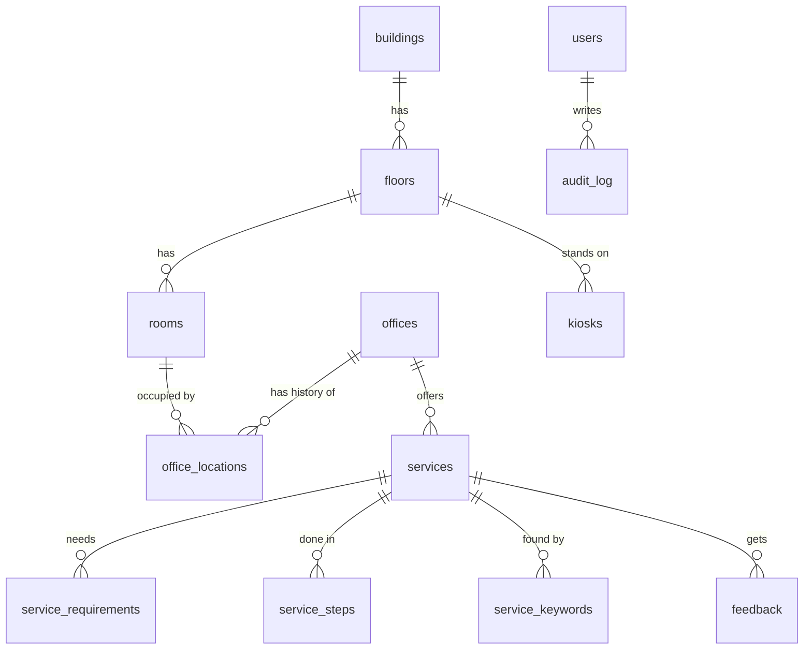

# Database

The database is SQLite in a single file, `server/data/kiosk.sqlite`. It runs through sql.js (SQLite compiled to WebAssembly), so there is no database server to install. The schema lives in `server/src/schema.sql`. Every write is saved atomically: the file is written to a temp file, then renamed into place.

To reset to the seeded state, run `npm run seed`. That re-imports the Citizen's Charter and rebuilds the placeholder rooms.

## The location model (why rooms can change)

- **rooms** holds the physical spaces. Each one has an `x, y, z` centre and an `approach_x/y/z` point, the corridor spot in front of the door where a route ends. It also has `facing_deg`, `width_m`, `depth_m`, `room_type`, `is_accessible` and `coord_source` (`seed_placeholder` → `manual` when edited in the admin panel → `unity_sync` when pushed from Unity). All values are metres, in the Unity convention: Y up, +X right facing the building, +Z into the building, with the origin at the main entrance.
- **offices** holds the departments. An office does **not** store its own position.
- **office_locations** links an office to a room over time. The row with `valid_to IS NULL` is the current location. Moving an office (`POST /api/admin/offices/:id/move`) closes the current row and inserts a new one in one transaction, so the full history is kept ("CCRO was in 1F-104 until 3 Nov, then 2F-205 during renovation").
- **v_office_current_location** is a view that joins an office to its current room, floor and coordinates. Unity's `/api/destinations` reads from it.
- **kiosks** stores each kiosk's own `x, y, z, facing_deg`. Every route starts from there.

This gives you three independent things that can change without touching code:

| Change in real life | What you do | What updates |
|---|---|---|
| An office moves to another room | Admin ▸ Offices ▸ Move office | Kiosk, phone page and Unity routes; history kept |
| A room was measured wrong | Admin ▸ Floors & rooms ▸ drag or type x/y/z, or Unity ▸ Push markers | Every office in that room |
| The kiosk is moved in the lobby | Admin ▸ Kiosks ▸ Edit | Every route's starting point |

Every write calls `bumpContentVersion()`. The web kiosk and Unity poll `/api/kiosk/version` and re-download when it changes; the web kiosk polls every 60 s and Unity every 30 s.

## Other tables

| Table | Purpose |
|---|---|
| `services` | Citizen's Charter services. Fields: `title` (official), `plain_title` (shown on the kiosk), fees, time, `status` (draft/published/archived), `is_citizen_facing`, `parse_quality`, `verified_at`, `view_count`, plus `pending_json`/`pending_by`/`pending_at` for proposals from office editors that are waiting for approval. |
| `service_requirements`, `service_steps`, `service_keywords` | Ordered child rows. Steps that share the same `client_action` show as one step with several office sub-steps. |
| `announcements` | Banner on the kiosk home screen, with a time window. |
| `feedback` | The "Was this helpful?" answers from the kiosk and the phone page. |
| `search_logs` | Every search with its result count. Searches with zero results are the to-do list for adding keywords. |
| `session_logs` | One row per kiosk session or navigation. Feeds the dashboard. |
| `users`, `sessions` | Admin accounts (scrypt-hashed passwords; locked for 15 min after 5 failed logins) and login sessions (10 h). |
| `audit_log` | Who changed what, with before and after JSON. |
| `settings` | Key/value pairs: `content_version`, `corridor_z`, and others. |

## Roles

| Role | Can do |
|---|---|
| `viewer` | Read everything in the admin panel |
| `office_editor` | Edit **their own office's** services. Changes to a published service wait for approval. |
| `lgu_admin` | Everything: approve, publish, move offices, edit rooms/kiosks/announcements, manage users |
| `system_admin` | Same as LGU admin, and can create or change other system admins |
